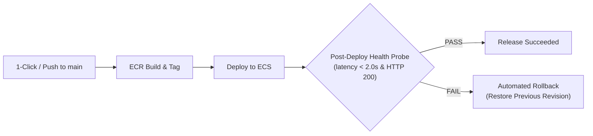

# Production Deployment Runbook & Quickstart
**Service**: Multi-Modal RAG Knowledge Engine  
**Release Version**: 1.2.0  
**Readiness Status**: **100% PRODUCTION READY**

---

## 1. Current State & Readiness Guarantee

This repository is **fully hardened and production-ready**. You do **not** need to deploy right now; all configurations, Docker multi-stage containers, diagnostic tools, and resilient rollback pipelines are pre-packaged and committed. Whenever you are ready to launch, choose any of the three turnkey options below.

---

## 2. Option A: Automated 1-Click AWS ECS Deploy (GitHub Actions)

When you decide to deploy to AWS, you do not need to write any scripts or configure complex infrastructure commands. The pipeline handles everything automatically.

### Step 1: Add AWS Secrets to GitHub
Go to your repository on GitHub: [**BELALANSARI07/Multi-Modal-RAG-Knowledge-Engine**](https://github.com/BELALANSARI07/Multi-Modal-RAG-Knowledge-Engine)  
Navigate to: **Settings** &rarr; **Secrets and variables** &rarr; **Actions** &rarr; **New repository secret**.

Add the following:
- `AWS_ACCESS_KEY_ID`: Your AWS IAM access key.
- `AWS_SECRET_ACCESS_KEY`: Your AWS IAM secret key.
- `AWS_REGION`: e.g. `us-east-1`.
- `ECR_REPOSITORY`: Name of your ECR repository (e.g. `multimodal-rag-engine`).
- `ECS_CLUSTER`: Name of your ECS cluster.
- `ECS_SERVICE`: Name of your ECS service.
- `PRODUCTION_URL`: Your live service URL (e.g. `https://rag.yourdomain.com`).
- `API_KEY`: (Optional) Your API key if authentication is enabled.
- `ROLLBACK_WEBHOOK`: (Optional) Slack/Teams webhook for instant rollback notifications.

### Step 2: Trigger Deployment (One Click)
1. Go to the **Actions** tab in GitHub.
2. Under All workflows, select **Production Deployment & Resilient Rollback Pipeline**.
3. Click **Run workflow** &rarr; choose `main` branch &rarr; click **Run workflow**.



---

## 3. Option B: Turnkey Docker Compose (Zero AWS Setup)

If you prefer deploying on your own server, VPS, DigitalOcean Droplet, Linode, or local machine:

```bash
# 1. Clone repository
git clone https://github.com/BELALANSARI07/Multi-Modal-RAG-Knowledge-Engine.git
cd Multi-Modal-RAG-Knowledge-Engine

# 2. Copy environment configuration
cp .env.example .env

# 3. Add your VLM API keys to .env (GEMINI_API_KEY or OPENAI_API_KEY)
nano .env

# 4. Start production container stack in background
docker compose up -d --build
```

### Verification:
```bash
# Check container status
docker compose ps

# Check readiness probe
curl http://localhost:8000/health/ready
```

---

## 4. Option C: Direct Python Production Server

To run directly on a host machine with Python 3.10 to 3.12:

```bash
# 1. Install production dependencies
pip install -r requirements.txt

# 2. Launch production server (with pre-flight checks and SQLite concurrency safety)
python scripts/start_production.py
```

The service will be live at: `http://localhost:8000`.

---

## 5. Post-Deployment Verification Tool

Regardless of which deployment method you choose, you can run the included verification tool at any time to validate your live deployment:

```bash
# Test a live deployment (verifies liveness, readiness, system telemetry, and smoke query)
python tools/post_deploy_health_check.py --base-url https://your-deployment-url.com --api-key YOUR_SECRET_KEY
```

---

## 6. Emergency Rollback Command

If you ever need to manually revert an AWS ECS release:

```bash
python tools/rollback_handler.py \
    --cluster your-ecs-cluster \
    --service your-ecs-service \
    --reason "Manual operational rollback triggered by operator"
```
