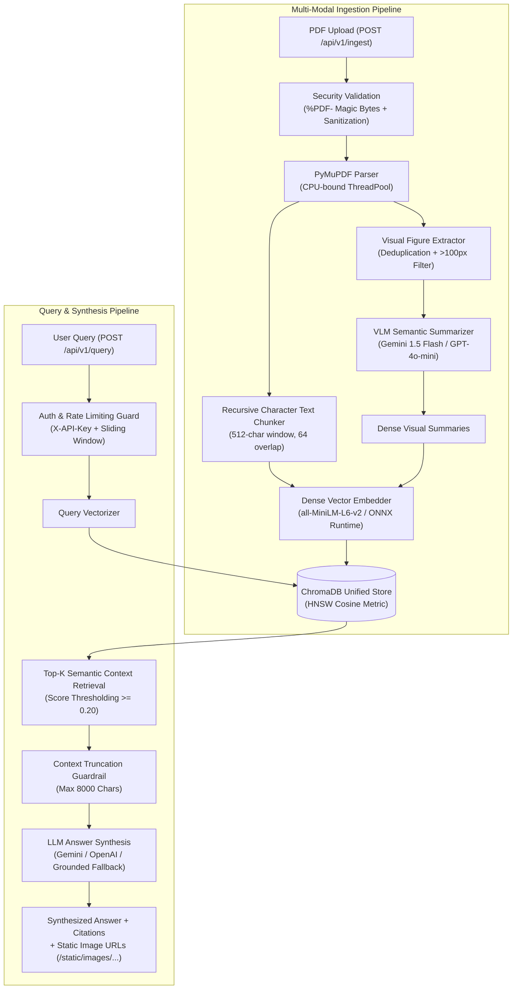

# Multi-Modal Retrieval-Augmented Generation (RAG) Knowledge Engine

[](https://www.python.org/)
[](https://fastapi.tiangolo.com/)
[](https://www.trychroma.com/)
[](https://github.com/BELALANSARI07/Multi-Modal-RAG-Knowledge-Engine/actions/workflows/ci.yml)
[](Dockerfile)
[](LICENSE)

An enterprise-grade, asynchronous **Multi-Modal RAG Knowledge Engine** designed to ingest complex technical PDF documents containing both unstructured narrative text and visual figures (charts, architecture diagrams, graphs).

By treating embedded visuals as first-class citizens, the engine routes extracted figures through Vision-Language Models (VLMs) to produce dense, factual descriptions. These visual summaries and text chunks are mapped into a single, unified vector space (ChromaDB) to enable multi-modal semantic retrieval and grounded answer synthesis.

---

## 🏛️ System Architecture



---

## ✨ Key Technical Highlights

- **Unified Multi-Modal Vector Space:** Text paragraphs and VLM visual figure summaries coexist in one ChromaDB collection, indexed with 384-dimensional normalized vectors.
- **Visual Deduplication & Normalization:** Filters out icons and UI decorations (<100px), computes SHA-256 visual hashes to prevent duplicate indexing across pages, and normalizes high-resolution charts with Lanczos resampling.
- **Enterprise Security Hardening:**
  - Validates `%PDF-` magic byte headers on uploads to prevent disguised payload attacks.
  - Path-traversal-proof filename sanitization strips relative sequences (`../`, `..\`) and controls.
  - Optional API Key authentication (`X-API-Key`) and per-client token-bucket rate limiting.
  - Shields internal database exceptions and stack traces from public API responses.
- **Transactional Ingestion & Cascade Rollback:** If embedding or ChromaDB upsert fails mid-run, all uploaded files and cropped images for that batch are automatically purged.
- **Resilient Dual-Engine Embeddings:** Employs Hugging Face `sentence-transformers` with an automatic, zero-overhead fallback to ONNX Runtime (`onnxruntime`), guaranteeing 100% portability across secure Windows environments (AppLocker/WDAC).
- **Production Containerization:** Multi-stage `Dockerfile` (non-root `appuser`) and `docker-compose.yml` with health checks and persistent volume mappings.
- **Automated CI/CD:** GitHub Actions workflow running Ruff linting, secret detection (Gitleaks), and full test matrix across Python 3.10, 3.11, and 3.12.
- **Comprehensive Test Suite:** 37 automated unit, integration, and security tests (100% pass rate).

---

## 📁 Repository Structure

```
multimodal-rag-engine/
│
├── .github/
│   ├── workflows/ci.yml            # CI/CD pipeline (Ruff, Gitleaks, Python 3.10-3.12)
│   ├── ISSUE_TEMPLATE/             # Bug report and feature request templates
│   └── PULL_REQUEST_TEMPLATE.md    # Pull request review template
│
├── app/
│   ├── __init__.py
│   ├── main.py                     # FastAPI factory, lifespan, CORS, and health probes
│   ├── config.py                   # Pydantic Settings with strict validation
│   │
│   ├── api/                        # REST API routing layer
│   │   ├── __init__.py
│   │   ├── router.py               # Aggregated /api/v1 router
│   │   ├── ingest.py               # POST /api/v1/ingest (PDF upload & extraction)
│   │   ├── query.py                # POST /api/v1/query (multi-modal RAG search)
│   │   ├── documents.py            # GET & DELETE /api/v1/documents
│   │   ├── dependencies.py         # Shared service injection from app.state
│   │   └── middleware.py           # Request ID, rate limiting, and API key auth
│   │
│   ├── core/                       # Ingestion algorithms
│   │   ├── __init__.py
│   │   ├── pdf_parser.py           # PyMuPDF parser with magic byte validation
│   │   ├── image_extractor.py      # Embedded image extraction, sizing & SHA-256 deduplication
│   │   ├── text_chunker.py         # Recursive character chunker with sliding overlap
│   │   └── exceptions.py           # Domain exception hierarchy
│   │
│   ├── services/                   # Business logic and external API integrations
│   │   ├── __init__.py
│   │   ├── embedding_service.py    # Dual-engine SentenceTransformer + ONNX Runtime (384-dim)
│   │   ├── vlm_service.py          # Gemini 1.5 Flash / GPT-4o-mini client with backoff
│   │   ├── vectorstore_service.py  # ChromaDB persistent collection manager
│   │   ├── ingestion_service.py    # Transactional ingestion orchestrator with rollback
│   │   └── retrieval_service.py    # Top-k retrieval, thresholding, and prompt synthesis
│   │
│   ├── models/                     # Data schemas & validation
│   │   ├── __init__.py
│   │   ├── schemas.py              # Pydantic v2 schemas for all requests and responses
│   │   └── enums.py                # ChunkType, VLMProvider enumerations
│   │
│   └── utils/                      # Utilities
│       ├── __init__.py
│       ├── file_utils.py           # Path sanitization, magic bytes, and deterministic IDs
│       └── logging_config.py       # Structured production logging
│
├── data/
│   ├── uploads/                    # Ingested PDF documents (.gitkeep)
│   └── extracted_images/           # Cropped diagrams & charts (served at /static/images)
│
├── chroma_db/                      # ChromaDB persistent vector database
├── tests/                          # 37 Pytest unit, integration, and security tests
│   ├── conftest.py                 # Shared fixtures with isolated test clients
│   ├── test_api.py                 # REST endpoint lifecycle tests
│   ├── test_security.py            # Path traversal, magic bytes, auth, rate limiting
│   ├── test_embedding_service.py   # Vector dimension and batch tests
│   ├── test_ingestion.py           # Pipeline integration and rollback tests
│   ├── test_pdf_parser.py          # Text/image extraction and empty doc tests
│   ├── test_text_chunker.py        # Boundary splitting and overlap tests
│   ├── test_vectorstore.py         # Vector similarity and cascade deletion
│   └── test_vlm_service.py         # Mocked Gemini/OpenAI calls and degradation
│
├── scripts/
│   └── seed_sample.py              # Synthetic demo generation & trial query script
├── .dockerignore
├── .env.example                    # Environment configuration template
├── .gitignore                      # Git exclusion rules
├── .gitleaks.toml                  # Secret scanning configuration
├── .python-version                 # Declares Python 3.10.11
├── CHANGELOG.md                    # Keep a Changelog documentation
├── CODE_OF_CONDUCT.md              # Contributor Covenant v2.1
├── CODEBASE_GUIDE.md               # Exhaustive file-by-file codebase guide
├── CONTRIBUTING.md                 # Contribution guidelines
├── Dockerfile                      # Production container image
├── docker-compose.yml              # Multi-container orchestration
├── LICENSE                         # MIT License
├── plan.md                         # Initial architecture blueprint
├── pyproject.toml                  # PEP 621 project configuration
├── pytest.ini                      # Pytest runner configuration
├── requirements.txt                # Pinned production dependencies
└── requirements-dev.txt            # Development and test dependencies
```

---

## 🚀 Quickstart Guide

### 1. Clone & Set Up Environment

```bash
git clone https://github.com/BELALANSARI07/Multi-Modal-RAG-Knowledge-Engine.git
cd Multi-Modal-RAG-Knowledge-Engine

# Create and activate virtual environment
python -m venv venv
source venv/bin/activate  # On Windows: .\venv\Scripts\activate

# Install dependencies
pip install -r requirements.txt
pip install -r requirements-dev.txt
```

### 2. Configure Environment

Copy the template configuration:

```bash
cp .env.example .env
```

Edit `.env` to configure your settings:

```ini
# Core Configuration
VLM_PROVIDER=gemini                     # "gemini" or "openai"
GEMINI_API_KEY=your_gemini_api_key      # Required for live Gemini VLM calls
OPENAI_API_KEY=your_openai_api_key      # Required for live OpenAI VLM calls
VLM_MODEL_NAME=gemini-1.5-flash
CHROMA_PERSIST_DIR=./chroma_db
CHROMA_COLLECTION_NAME=knowledge_base

# Security & Rate Limiting
API_KEY=                                # Leave empty to disable authentication
RATE_LIMIT_ENABLED=true
RATE_LIMIT_REQUESTS_PER_MINUTE=60
RATE_LIMIT_BACKEND=memory               # "memory" (process-local) or "redis" (multi-worker)
REDIS_URL=                              # e.g., redis://localhost:6379/0 (if using redis backend)
```

> **Live vs. Offline Local Fallback:**
> - **Live Mode:** Provide a valid `GEMINI_API_KEY` (or `OPENAI_API_KEY`) to enable live multi-modal visual summarization and answer generation.
> - **Offline Fallback Mode:** When API keys are left unset or placeholder values (`your_...`), the engine automatically switches to a deterministic, zero-cost local grounded synthesizer and structured visual description generator. This allows end-to-end integration testing and offline development without external API costs or internet dependency.

### 3. Run the Demonstration Seed Script

To test the ingestion, visual cropping, and multi-modal query without starting the server:

```bash
python scripts/seed_sample.py
```

### 4. Start the Production Server

```bash
uvicorn app.main:app --host 0.0.0.0 --port 8000 --reload
```

Interactive OpenAPI Swagger UI is available at `http://127.0.0.1:8000/docs`.

---

## 🐳 Docker Deployment

The application includes a production-ready, **multi-stage Dockerfile** that builds isolated binary wheels in a builder stage and executes in a hardened runner container under a dedicated non-root user (`appuser`, UID 1000).

To launch the complete engine inside Docker with persistent volumes for ChromaDB and uploads:

```bash
# 1. Initialize environment configuration
cp .env.example .env

# 2. Build and launch container
docker compose up --build -d
```

Check container status and logs:

```bash
docker compose ps
docker compose logs -f
```

Verify container readiness and health probes:

```bash
curl http://localhost:8000/health/live
curl http://localhost:8000/health/ready
```

> **Multi-Worker Concurrency Note:**
> By default, the production container runs with 1 Uvicorn worker. In-process ChromaDB utilizes an embedded SQLite database which is optimized for single-process write access. Furthermore, the default `memory` rate limiter is process-local. If scaling to multiple workers or multi-container clusters, configure `RATE_LIMIT_BACKEND=redis` with a shared `REDIS_URL`, and utilize a standalone client/server ChromaDB deployment.

---

## 📡 API Reference

### 1. Ingest PDF Document
`POST /api/v1/ingest` (multipart/form-data)

- **Headers:** `X-API-Key: <token>` (if `API_KEY` is configured in `.env`)
- **Body:** `file`: Binary PDF file (Max 50 MB, must have valid `%PDF-` header).

```bash
curl -X POST "http://127.0.0.1:8000/api/v1/ingest" \
  -H "X-API-Key: your_key_here" \
  -F "file=@data/uploads/sample_quarterly_report.pdf"
```

**Response (200 OK):**
```json
{
  "status": "success",
  "document_id": "sample_quarterly_report_4e81fb",
  "filename": "sample_quarterly_report.pdf",
  "stats": {
    "total_pages": 2,
    "text_chunks": 3,
    "images_extracted": 1,
    "images_summarized": 1
  },
  "message": "Successfully indexed 4 multi-modal chunks into ChromaDB"
}
```

---

### 2. Multi-Modal Natural Language Query
`POST /api/v1/query` (application/json)

```bash
curl -X POST "http://127.0.0.1:8000/api/v1/query" \
  -H "Content-Type: application/json" \
  -H "X-API-Key: your_key_here" \
  -d '{
    "question": "What were the quarterly latency and accuracy trends?",
    "top_k": 3,
    "include_sources": true
  }'
```

**Response (200 OK):**
```json
{
  "question": "What were the quarterly latency and accuracy trends?",
  "answer": "According to Figure 1 on page 2, query accuracy scaled progressively across each quarter, reaching peak performance of 94% following the introduction of the unified multi-modal index. The visual bar chart outlines progression from Q1 through Q4.",
  "sources": [
    {
      "content_preview": "Figure 1: Quarterly Model Latency and Accuracy Metrics Analysis of Figure 1...",
      "source_pdf": "sample_quarterly_report.pdf",
      "page_number": 2,
      "chunk_type": "text",
      "relevance_score": 0.8521,
      "image_path": null,
      "image_url": null
    },
    {
      "content_preview": "Visual graphic extracted from sample_quarterly_report.pdf on page 2. Displays structured visual metrics...",
      "source_pdf": "sample_quarterly_report.pdf",
      "page_number": 2,
      "chunk_type": "image_summary",
      "relevance_score": 0.7842,
      "image_path": "data/extracted_images/sample_quarterly_report/sample_quarterly_report_p2_img0.png",
      "image_url": "/static/images/sample_quarterly_report/sample_quarterly_report_p2_img0.png"
    }
  ],
  "metadata": {
    "model_used": "gemini/gemini-1.5-flash",
    "retrieval_time_ms": 14.25,
    "generation_time_ms": 1120.4,
    "total_sources": 2
  }
}
```

---

### 3. Document Management
- **List Ingested Documents:** `GET /api/v1/documents`
- **Cascade Delete Document:** `DELETE /api/v1/documents/{filename}` (purges ChromaDB vectors, source PDF on disk, and extracted image directory).

---

### 4. Health Probes
- `GET /health`: Comprehensive status (ChromaDB connection, total vectors, active embedding engine, VLM status).
- `GET /health/live`: Liveness check (HTTP 200).
- `GET /health/ready`: Readiness check (verifies database responsiveness).

---

## 🔧 Windows & Enterprise Security Notes

On certain Windows environments with **Application Control / WDAC / AppLocker** policies enabled, PyTorch's native `torch_python.dll` may be restricted from loading in user AppData directories (`[WinError 4551]`).

**Our Architecture Solution:**
The `EmbeddingService` incorporates an automated dual-engine design:
1. It attempts to load `sentence-transformers`.
2. If blocked by OS security or if PyTorch is unavailable, it automatically activates the high-performance **ONNX Runtime engine** (`all-MiniLM-L6-v2/onnx.tar.gz`), running identical 384-dimensional normalized embeddings with faster CPU inference and zero DLL restrictions.

---

## 🧪 Testing

Execute the complete automated test suite across all units, security controls, and integration pipelines:

```bash
pytest tests/ -v
```

---

## 📄 License

This project is licensed under the [MIT License](LICENSE).
