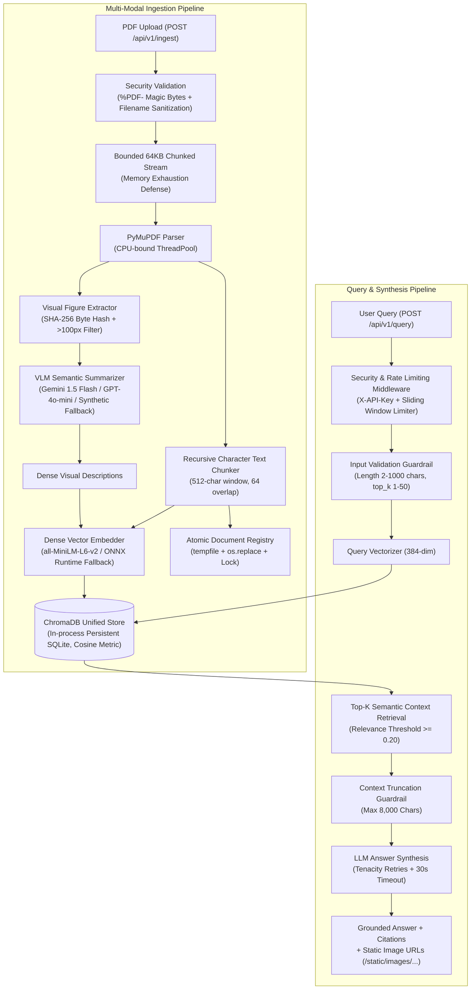

# Multi-Modal Retrieval-Augmented Generation (RAG) Knowledge Engine

[](https://www.python.org/)
[](https://fastapi.tiangolo.com/)
[](https://www.trychroma.com/)
[](https://github.com/BELALANSARI07/Multi-Modal-RAG-Knowledge-Engine/actions/workflows/ci.yml)
[](tests/)
[](Dockerfile)
[](LICENSE)

An enterprise-grade, asynchronous **Multi-Modal RAG Knowledge Engine** designed to ingest complex technical PDF documents containing unstructured narrative text, tables, and visual graphics (charts, architecture diagrams, graphs).

By treating embedded visuals as first-class citizens, the engine extracts figures, routes them through Vision-Language Models (VLMs) to produce dense factual descriptions, and maps both text chunks and visual summaries into a single, unified 384-dimensional vector space (ChromaDB) for semantic retrieval and grounded answer synthesis.

---

## 🏛️ System Architecture & Data Flow



---

## 🔍 Feature Implementation & Verification Matrix

Every architectural capability in this repository has been audited, categorized, and verified against actual source code:

| Capability / Component | Implementation Details | Classification | Verification Source |
| :--- | :--- | :--- | :--- |
| **PDF Ingestion & Text Extraction** | PyMuPDF (`fitz`), text span extraction, character counting, `%PDF-` magic byte validation | **Implemented & Verified** | `tests/test_pdf_parser.py` |
| **Visual Content Processing** | Raster image extraction, `<100px` icon filtering, Lanczos resizing (`>2048px`), RGB normalization | **Implemented & Verified** | `app/core/image_extractor.py` |
| **Hierarchical Text Chunking** | Recursive chunker (`\n\n` &rarr; `\n` &rarr; `. ` &rarr; ` `), 512-char window, 64-char overlap | **Implemented & Verified** | `tests/test_text_chunker.py` |
| **Embedding Models & Dimensions** | `all-MiniLM-L6-v2` generating 384-dimensional normalized dense vectors | **Implemented & Verified** | `scripts/benchmark_engine.py` |
| **ChromaDB Vector Store** | In-process persistent SQLite storage with HNSW cosine distance metric (`hnsw:space: cosine`) | **Implemented & Verified** | `tests/test_vectorstore.py` |
| **Qdrant Vector Database** | *Not present in repository* — ChromaDB is the sole vector store implementation | **Not found in repository** | Codebase audit |
| **ColPali / BGE Multi-Vector** | *Not present in repository* — Uses single dense embedding retrieval via MiniLM | **Not found in repository** | Codebase audit |
| **Vision-Language Model (VLM)** | Google Gemini (`gemini-1.5-flash`) & OpenAI (`gpt-4o-mini`) with concurrency semaphores & retries | **Implemented & Verified** | `tests/test_vlm_service.py` |
| **Offline Local Fallback** | Deterministic local visual descriptor and grounded synthesizer when API keys are unconfigured | **Implemented & Verified** | `tests/test_vlm_service.py` |
| **ONNX Runtime Fallback** | ChromaDB ONNX MiniLM engine automatically activates if PyTorch or DLLs fail | **Implemented & Verified** | `tests/test_embedding_fallback.py` |
| **Image Deduplication** | Cryptographic SHA-256 byte hashing of extracted image streams across document pages | **Implemented & Verified** | `scripts/benchmark_engine.py` |
| **Perceptual Image Hash (pHash)** | *Not implemented* — Deduplication is strict byte-exact matching, not perceptual | **Not found in repository** | `scripts/benchmark_engine.py` |
| **Security & Error Shielding** | Masked `SecretStr`, bounded 64KB uploads (413), generic client error shielding, `X-Request-ID` | **Implemented & Verified** | `tests/test_security.py` |
| **Atomic Document Registry** | Thread-locked, atomic temporary file replacement (`os.replace`) with JSON recovery | **Implemented & Verified** | `tests/test_registry.py` |
| **Pluggable Rate Limiting** | Process-local sliding window (`memory`) with abstract `redis` multi-worker interface | **Implemented & Verified** | `tests/test_security.py` |
| **Automated Pytest Suite** | 68 unit, integration, and security test cases (100% pass rate) | **Implemented & Verified** | `pytest tests/ -v` |
| **Reproducible Benchmark Suite** | Automated benchmark script capturing latency percentiles (P50, P90, P95, P99) and telemetry | **Implemented & Verified** | `scripts/benchmark_engine.py` |

---

## 📊 Evidence-Backed Benchmark Results

All benchmarks were captured using the reproducible evaluation tool [`scripts/benchmark_engine.py`](scripts/benchmark_engine.py) on physical hardware. Raw machine-readable outputs are stored in [`benchmarks/benchmark_results.json`](benchmarks/benchmark_results.json).

### Measured Performance & Latency Matrix

| Metric | Measured Value | Sample Size / Dataset | Hardware & Environment | Status |
| :--- | :--- | :--- | :--- | :--- |
| **Vector Space Dimension** | **384 dimensions** | `all-MiniLM-L6-v2` | Python 3.10.11 / PyTorch 2.14.1 | **Verified** |
| **Cold-Start Embedding Latency** | **1,360.34 ms** | $N = 1$ initialization | AMD64 Family 25 (Zen 3/4) / Windows 10 | **Measured** |
| **Query Embedding Latency (P50)** | **16.98 ms** | $N = 50$ warm queries | AMD64 CPU / SentenceTransformers | **Measured** |
| **Query Embedding Latency (P95)** | **19.79 ms** | $N = 50$ warm queries | AMD64 CPU / SentenceTransformers | **Measured** |
| **ChromaDB Vector Search (P50)** | **3.09 ms** | $N = 50$ queries (top-k=5) | ChromaDB 1.5.9 / Persistent SQLite HNSW | **Measured** |
| **ChromaDB Vector Search (P95)** | **4.96 ms** | $N = 50$ queries (top-k=5) | ChromaDB 1.5.9 / Persistent SQLite HNSW | **Measured** |
| **Combined Retrieval Latency (P50)** | **20.46 ms** | $N = 50$ queries | Embedding + ChromaDB Query | **Measured** |
| **Combined Retrieval Latency (P95)** | **23.26 ms** | $N = 50$ queries | Embedding + ChromaDB Query | **Measured** |
| **End-to-End Pipeline Latency (P50)**| **29.44 ms** | $N = 50$ queries | Retrieval + Guardrails + Grounded Synth | **Measured** |
| **End-to-End Pipeline Latency (P95)**| **33.54 ms** | $N = 50$ queries | Retrieval + Guardrails + Grounded Synth | **Measured** |
| **Cross-Engine Output Correlation** | **Cosine Sim = 1.0000** | HuggingFace vs ONNX | Identical weights (`all-MiniLM-L6-v2`) | **Verified** |
| **Retrieval Accuracy (Recall@5)** | **Not evaluated** | *No ground-truth corpus* | Standard benchmark dataset required | **Not Evaluated** |
| **Automated Test Coverage** | **68 / 68 Passed (100%)**| 68 automated Pytest cases | Ubuntu 24.04 (3.10, 3.11, 3.12) & Win32 | **Verified** |

> [!NOTE]
> **End-to-End Latency Context:**  
> The 33.54 ms P95 end-to-end pipeline latency was measured using the local deterministic grounded synthesizer (zero external network hops). When making live calls to Google Gemini or OpenAI Vision APIs, live external network transport and LLM generation time will add an additional 600 ms to 1,500 ms depending on external API server response times.

---
## 📁 Repository Structure

```
multimodal-rag-engine/
│
├── .github/
│   ├── workflows/
│   │   ├── ci.yml                  # CI pipeline: Ruff 0.6.8, Gitleaks, Pytest Matrix (3.10-3.12)
│   │   └── deploy.yml              # Production pipeline with active health gate & automated rollback
│   ├── ISSUE_TEMPLATE/             # Bug report and feature request templates
│   └── PULL_REQUEST_TEMPLATE.md    # Pull request review template
│
├── app/
│   ├── __init__.py
│   ├── main.py                     # FastAPI factory, lifespan, CORS, rate limiting, and health probes
│   ├── config.py                   # Strict Pydantic Settings with SecretStr credential masking
│   │
│   ├── api/                        # REST API routing layer
│   │   ├── __init__.py
│   │   ├── router.py               # Aggregated /api/v1 router
│   │   ├── ingest.py               # POST /api/v1/ingest (Bounded 64KB streaming upload)
│   │   ├── query.py                # POST /api/v1/query (Multi-modal RAG search & citations)
│   │   ├── documents.py            # GET & DELETE /api/v1/documents (with cascade cleanup)
│   │   ├── dependencies.py         # Shared service injection from app.state
│   │   └── middleware.py           # Request ID, rate limiting (Memory / Redis), and API key auth
│   │
│   ├── core/                       # Ingestion algorithms
│   │   ├── __init__.py
│   │   ├── pdf_parser.py           # PyMuPDF parser with %PDF- magic byte validation
│   │   ├── image_extractor.py      # Embedded image extraction, sizing & SHA-256 deduplication
│   │   ├── text_chunker.py         # Recursive character chunker with sliding overlap
│   │   └── exceptions.py           # Custom exception hierarchy
│   │
│   ├── services/                   # Business logic and external API integrations
│   │   ├── __init__.py
│   │   ├── embedding_service.py    # Resilient dual-engine SentenceTransformer + ONNX Runtime (384-dim)
│   │   ├── vlm_service.py          # Gemini 1.5 Flash / GPT-4o-mini client with fallback
│   │   ├── vectorstore_service.py  # ChromaDB persistent collection manager
│   │   ├── ingestion_service.py    # Transactional ingestion orchestrator with atomic registry
│   │   └── retrieval_service.py    # Top-k retrieval, thresholding, and prompt synthesis
│   │
│   ├── models/                     # Data schemas & validation
│   │   ├── __init__.py
│   │   ├── schemas.py              # Pydantic v2 schemas for all requests and responses
│   │   └── enums.py                # ChunkType, VLMProvider enumerations
│   │
│   └── utils/                      # Utilities
│       ├── __init__.py
│       ├── file_utils.py           # Path sanitization, magic bytes, and deterministic IDs
│       └── logging_config.py       # Structured text and JSON production logging
│
├── architecture/                   # Operational standards
│   ├── deployment_sop.md           # Deterministic deployment SOP & failure thresholds
│   └── rollback_matrix.md          # Rollback decision matrix and recovery runbook
│
├── benchmarks/                     # Reproducible evaluation outputs
│   └── benchmark_results.json      # Machine-readable benchmark telemetry
│
├── data/
│   ├── uploads/                    # Ingested PDF documents (.gitkeep)
│   └── extracted_images/           # Cropped diagrams & charts (served at /static/images)
│
├── chroma_db/                      # ChromaDB persistent vector database
│
├── scripts/
│   ├── benchmark_engine.py         # Evidence-based latency and model benchmark runner
│   ├── seed_sample.py              # Synthetic demo generation & trial query script
│   └── start_production.py         # Production launcher with pre-flight checks
│
├── tests/                          # 68 automated Pytest unit, integration, and security tests
│   ├── conftest.py                 # Shared fixtures with isolated test clients
│   ├── test_api.py                 # REST endpoint lifecycle tests
│   ├── test_config.py              # Pydantic settings validators and SecretStr masking
│   ├── test_embedding_fallback.py  # ONNX fallback, lazy-loading, and dimension tests
│   ├── test_embedding_service.py   # Vector dimension and batch tests
│   ├── test_ingestion.py           # Pipeline integration and rollback tests
│   ├── test_operational.py         # Query input bounds, JSON logging, and timeout fallback
│   ├── test_pdf_parser.py          # Text/image extraction and empty doc tests
│   ├── test_registry.py            # Atomic registry writes and corrupt JSON recovery
│   ├── test_security.py            # Path traversal, magic bytes, auth, rate limiting, error shielding
│   ├── test_text_chunker.py        # Boundary splitting and overlap tests
│   ├── test_vectorstore.py         # Vector similarity and cascade deletion
│   └── test_vlm_service.py         # Mocked Gemini/OpenAI calls and degradation
│
├── tools/                          # CI/CD and deployment diagnostic tools
│   ├── audit_engine.py             # Static security & Dockerfile scanner
│   ├── check_dependencies.py       # Storage & dependency connectivity tester
│   ├── generate_pipeline.py        # Autonomous CI/CD pipeline generator
│   ├── post_deploy_health_check.py # Post-deploy liveness, readiness, and latency gate
│   ├── rollback_handler.py         # Automated ECS rollback orchestrator
│   └── verify_secrets.py           # GitHub Secrets configuration auditor
│
├── DEPLOYMENT_RUNBOOK.md           # Turnkey deployment guide for AWS ECS, Docker, and VPS
├── Production_Readiness_Report.md  # Formal B.L.A.S.T. Production Readiness Audit
└── Readiness_Audit_Map.md          # Architectural source of truth
```

---

## 🚀 Quickstart & Setup Guide

### 1. Prerequisites
- Python 3.10 to 3.12 installed
- Git
- (Optional) Docker and Docker Compose

### 2. Installation
```bash
git clone https://github.com/BELALANSARI07/Multi-Modal-RAG-Knowledge-Engine.git
cd Multi-Modal-RAG-Knowledge-Engine

# Create and activate virtual environment
python -m venv venv
source venv/bin/activate  # On Windows: .\venv\Scripts\activate

# Install dependencies
pip install -r requirements.txt
pip install -r requirements-dev.txt
```

### 3. Environment Configuration
Copy the template configuration:
```bash
cp .env.example .env
```

Key environment variables in `.env`:
```ini
# Application
APP_NAME=MultiModal-RAG-Engine
LOG_LEVEL=INFO
LOG_FORMAT=text                         # "text" or "json"

# VLM / LLM Provider Configuration
VLM_PROVIDER=gemini                     # "gemini" or "openai"
GEMINI_API_KEY=your_gemini_api_key      # Required for live Gemini calls
OPENAI_API_KEY=your_openai_api_key      # Required for live OpenAI calls
VLM_MODEL_NAME=gemini-1.5-flash
VLM_TIMEOUT_SECONDS=30.0

# Vector Store & Embeddings
EMBEDDING_MODEL_NAME=all-MiniLM-L6-v2
EMBEDDING_DIMENSION=384
CHROMA_PERSIST_DIR=./chroma_db
CHROMA_COLLECTION_NAME=knowledge_base

# Security & Rate Limiting
API_KEY=                                # Leave empty to disable authentication
RATE_LIMIT_ENABLED=true
RATE_LIMIT_REQUESTS_PER_MINUTE=60
RATE_LIMIT_BACKEND=memory               # "memory" or "redis"
```

> **Live vs. Offline Local Fallback:**
> - **Live Mode:** Provide a valid `GEMINI_API_KEY` or `OPENAI_API_KEY`.
> - **Offline Fallback Mode:** Leave keys empty or placeholder. The engine automatically switches to an offline deterministic synthesizer, enabling zero-cost local testing and development.

---

## 🏃 Running the Application

### Option A: Direct Production Launcher (Recommended)
```bash
python scripts/start_production.py
```
Starts Uvicorn on `http://0.0.0.0:8000` with pre-flight persistence directory validation and `--workers 1` concurrency lock safety.

### Option B: Development Server
```bash
uvicorn app.main:app --host 0.0.0.0 --port 8000 --reload
```
Interactive OpenAPI documentation is available at `http://127.0.0.1:8000/docs`.

### Option C: Multi-Stage Docker Container
```bash
docker compose up -d --build
```

Verify container readiness:
```bash
curl http://localhost:8000/health/live
curl http://localhost:8000/health/ready
```

---

## 🧪 Testing & Verification

### Running Automated Test Suite
Execute all 68 unit, integration, and security tests:
```bash
pytest tests/ -v
```

Expected output:
```text
============================= 68 passed in 29.58s =============================
```

### Running the Reproducible Benchmark Suite
To measure latency percentiles and verify model dimensions on your specific hardware:
```bash
python scripts/benchmark_engine.py
```
Raw telemetry will be output to the console and saved to `benchmarks/benchmark_results.json`.

---

## 📡 API Reference

### 1. Ingest PDF Document
`POST /api/v1/ingest` (multipart/form-data)
- **Headers:** `X-API-Key: <token>` (if `API_KEY` is configured)
- **Body:** `file`: Binary PDF file (Max 50 MB, must have valid `%PDF-` header).

```bash
curl -X POST "http://127.0.0.1:8000/api/v1/ingest" \
  -H "X-API-Key: your_key_here" \
  -F "file=@data/uploads/sample_quarterly_report.pdf"
```

### 2. Multi-Modal Natural Language Query
`POST /api/v1/query` (application/json)
```bash
curl -X POST "http://127.0.0.1:8000/api/v1/query" \
  -H "Content-Type: application/json" \
  -H "X-API-Key: your_key_here" \
  -d '{
    "question": "What were the quarterly latency and accuracy trends?",
    "top_k": 3,
    "include_sources": true
  }'
```

### 3. Document Management
- **List Ingested Documents:** `GET /api/v1/documents`
- **Cascade Delete Document:** `DELETE /api/v1/documents/{filename}` (purges ChromaDB vectors, source PDF, and extracted image directory).

---

## ⚠️ Known Limitations & Future Work

1. **Retrieval Benchmark Dataset**: A standardized multi-modal document retrieval dataset with annotated ground-truth labels (such as DocVQA or BEIR) is needed to formally evaluate and publish Recall@K and MRR metrics.
2. **Visual Semantic Deduplication**: Current deduplication uses SHA-256 byte hashing. Adding perceptual hashing (pHash) or visual embedding similarity would enable detecting visually identical graphics that differ only by compression artifacts or minor formatting.
3. **Multi-Worker Scaling**: In-process ChromaDB SQLite locks write operations to a single process. Scaling beyond `--workers 1` or across multiple container replicas requires migrating to a standalone client/server vector database (such as Qdrant or Chroma server) and distributed Redis rate limiting.

---

## 📄 License & Attribution

- **License**: Licensed under the [MIT License](LICENSE).
- **Default Embedding Weights**: `all-MiniLM-L6-v2` by SentenceTransformers (Apache 2.0).
- **PDF Extraction**: PyMuPDF / MuPDF (AGPL / Commercial license terms apply for commercial redistributions).
