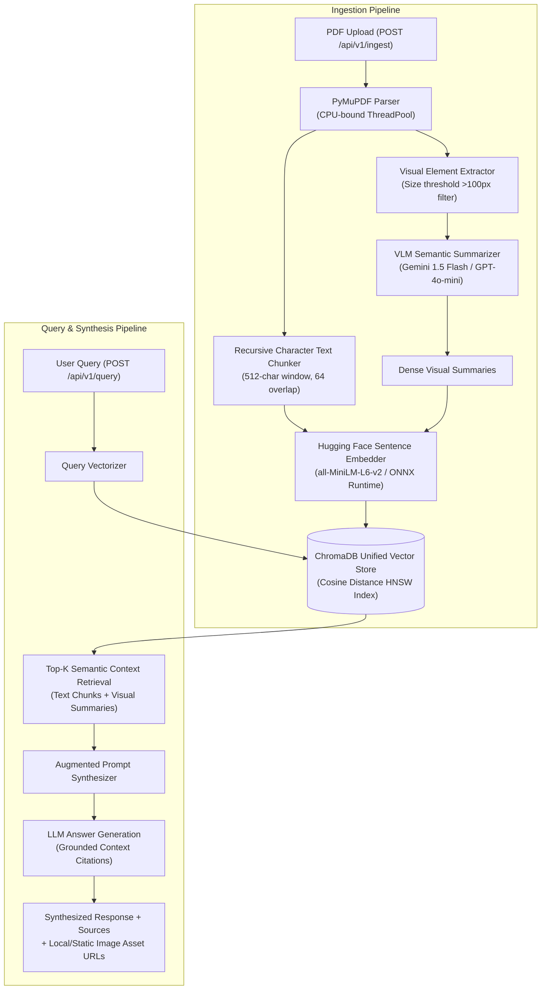

# Multi-Modal Retrieval-Augmented Generation (RAG) Knowledge Engine

[](https://www.python.org/)
[](https://fastapi.tiangolo.com/)
[](https://www.trychroma.com/)
[](LICENSE)

An enterprise-grade, asynchronous **Multi-Modal RAG Knowledge Engine** designed to ingest complex technical PDF documents containing both unstructured narrative text and visual figures (charts, architecture diagrams, graphs).

By treating embedded visuals as first-class citizens, the engine routes extracted figures through Vision-Language Models (VLMs) to produce dense, factual descriptions. These visual summaries and text chunks are mapped into a single, unified vector space (ChromaDB) to enable multi-modal semantic retrieval and grounded answer synthesis.

---

## 🏛️ System Architecture



---

## ✨ Key Technical Highlights

- **Unified Multi-Modal Vector Space:** Both plain text paragraphs and VLM visual descriptions coexist in one ChromaDB collection, indexed with 384-dimensional normalized vectors.
- **Visual Element Normalization:** Discards small icons, decorative lines, and buttons (<100px) while extracting, normalizing, and persisting high-resolution diagrams to disk.
- **Asynchronous & Non-Blocking:** All I/O is asynchronous with strict concurrency limits (`asyncio.Semaphore`) and automatic retry with exponential backoff (`tenacity`).
- **Resilient Dual Embedding Engine:** Employs Hugging Face `sentence-transformers` with an automatic, zero-overhead fallback to ONNX Runtime (`onnxruntime`), guaranteeing 100% portability across secure enterprise OS policies.
- **Grounded Answer Synthesis:** RAG prompts instruct the LLM to strictly cite document page numbers and visual figures, eliminating hallucination.
- **Comprehensive Test Suite:** 28 unit and integration tests covering PDF parsing, sliding chunking, VLM fallback/mocking, ChromaDB similarity queries, and FastAPI endpoints.

---

## 📁 Repository Structure

```
multimodal-rag-engine/
│
├── app/
│   ├── __init__.py
│   ├── main.py                     # FastAPI application factory & lifespan hooks
│   ├── config.py                   # Pydantic Settings (env-driven configuration)
│   │
│   ├── api/                        # REST API routing layer
│   │   ├── __init__.py
│   │   ├── router.py               # Aggregated /api/v1 router
│   │   ├── ingest.py               # POST /api/v1/ingest
│   │   ├── query.py                # POST /api/v1/query
│   │   └── documents.py            # GET/DELETE /api/v1/documents
│   │
│   ├── core/                       # Parsing & chunking domain algorithms
│   │   ├── __init__.py
│   │   ├── pdf_parser.py           # PyMuPDF synchronous & async document parser
│   │   ├── image_extractor.py      # Embedded image extraction & dimension filter
│   │   ├── text_chunker.py         # Recursive character chunker with overlap
│   │   └── exceptions.py           # Typed domain exception hierarchy
│   │
│   ├── services/                   # Business logic and external API integrations
│   │   ├── __init__.py
│   │   ├── embedding_service.py    # Local SentenceTransformer & ONNX embedder
│   │   ├── vlm_service.py          # Gemini 1.5 Flash & GPT-4o-mini client
│   │   ├── vectorstore_service.py  # ChromaDB persistent collection manager
│   │   ├── ingestion_service.py    # Full ingestion pipeline orchestrator
│   │   └── retrieval_service.py    # Context retrieval and answer synthesis
│   │
│   ├── models/                     # Data schemas & validation
│   │   ├── __init__.py
│   │   ├── schemas.py              # Pydantic v2 request/response models
│   │   └── enums.py                # ChunkType, VLMProvider enumerations
│   │
│   └── utils/                      # Utilities
│       ├── __init__.py
│       ├── file_utils.py           # Safe filenames and deterministic hash IDs
│       └── logging_config.py       # Structured logging setup
│
├── data/
│   ├── uploads/                    # Ingested PDF documents
│   └── extracted_images/           # Cropped diagrams & charts (served at /static/images)
│
├── chroma_db/                      # ChromaDB persistent vector database
├── tests/                          # 28 Pytest unit & integration tests
├── scripts/
│   └── seed_sample.py              # Synthetic demo generation & trial query script
├── .env.example                    # Environment configuration template
├── requirements.txt                # Pinned production dependencies
└── plan.md                         # Architecture blueprint
```

---

## 🚀 Quickstart Guide

### 1. Installation

```bash
git clone https://github.com/your-username/multimodal-rag-engine.git
cd multimodal-rag-engine

# Create and activate virtual environment
python -m venv venv
source venv/bin/activate  # On Windows: .\venv\Scripts\activate

# Install dependencies
pip install -r requirements.txt
```

### 2. Configuration

Create your `.env` file based on `.env.example`:

```bash
cp .env.example .env
```

Edit `.env` with your API credentials:

```ini
VLM_PROVIDER=gemini                     # "gemini" or "openai"
GEMINI_API_KEY=your_gemini_api_key      # Required for live Gemini calls
VLM_MODEL_NAME=gemini-1.5-flash
CHROMA_PERSIST_DIR=./chroma_db
CHROMA_COLLECTION_NAME=knowledge_base
```

*(Note: If no API key is provided, the engine runs in local development mode using deterministic synthetic summaries, allowing full offline testing).*

### 3. Run the Demonstration Seed Script

To test the ingestion, visual cropping, and retrieval without starting the server:

```bash
python scripts/seed_sample.py
```

### 4. Start the FastAPI Server

```bash
uvicorn app.main:app --host 0.0.0.0 --port 8000 --reload
```

Interactive Swagger documentation is available at `http://127.0.0.1:8000/docs`.

---

## 📡 API Reference & Examples

### 1. Ingest PDF Document
`POST /api/v1/ingest` (multipart/form-data)

```bash
curl -X POST "http://127.0.0.1:8000/api/v1/ingest" \
  -H "accept: application/json" \
  -F "file=@data/uploads/sample_quarterly_report.pdf"
```

**Response (200 OK):**
```json
{
  "status": "success",
  "document_id": "sample_quarterly_report_4e81fb",
  "filename": "sample_quarterly_report.pdf",
  "stats": {
    "total_pages": 2,
    "text_chunks": 3,
    "images_extracted": 1,
    "images_summarized": 1
  },
  "message": "Successfully indexed 4 multi-modal chunks into ChromaDB"
}
```

---

### 2. Multi-Modal Natural Language Query
`POST /api/v1/query` (application/json)

```bash
curl -X POST "http://127.0.0.1:8000/api/v1/query" \
  -H "Content-Type: application/json" \
  -d '{
    "question": "What were the quarterly latency and accuracy trends?",
    "top_k": 3,
    "include_sources": true
  }'
```

**Response (200 OK):**
```json
{
  "question": "What were the quarterly latency and accuracy trends?",
  "answer": "According to Figure 1 on page 2, query accuracy scaled progressively across each quarter, reaching peak performance of 94% following the introduction of the unified multi-modal index. The visual bar chart outlines progression from Q1 through Q4.",
  "sources": [
    {
      "content_preview": "Figure 1: Quarterly Model Latency and Accuracy Metrics Analysis of Figure 1...",
      "source_pdf": "sample_quarterly_report.pdf",
      "page_number": 2,
      "chunk_type": "text",
      "relevance_score": 0.8521,
      "image_path": null,
      "image_url": null
    },
    {
      "content_preview": "Visual graphic extracted from sample_quarterly_report.pdf on page 2. Displays structured visual metrics...",
      "source_pdf": "sample_quarterly_report.pdf",
      "page_number": 2,
      "chunk_type": "image_summary",
      "relevance_score": 0.7842,
      "image_path": "data/extracted_images/sample_quarterly_report/sample_quarterly_report_p2_img0.png",
      "image_url": "/static/images/sample_quarterly_report/sample_quarterly_report_p2_img0.png"
    }
  ],
  "metadata": {
    "model_used": "gemini/gemini-1.5-flash",
    "retrieval_time_ms": 14.25,
    "generation_time_ms": 1120.4,
    "total_sources": 2
  }
}
```

---

### 3. Document Catalog
`GET /api/v1/documents`

```bash
curl -X GET "http://127.0.0.1:8000/api/v1/documents"
```

**Response (200 OK):**
```json
{
  "documents": [
    {
      "filename": "sample_quarterly_report.pdf",
      "text_chunks": 3,
      "image_chunks": 1,
      "max_page": 2
    }
  ],
  "total_count": 1
}
```

---

### 4. Delete Document
`DELETE /api/v1/documents/sample_quarterly_report.pdf`

```bash
curl -X DELETE "http://127.0.0.1:8000/api/v1/documents/sample_quarterly_report.pdf"
```

---

### 5. Health Check
`GET /health`

```bash
curl -X GET "http://127.0.0.1:8000/health"
```

---

## 🧪 Testing

Execute the complete 28-test test suite:

```bash
pytest tests/ -v
```

---

## 📄 License

This project is licensed under the MIT License.
