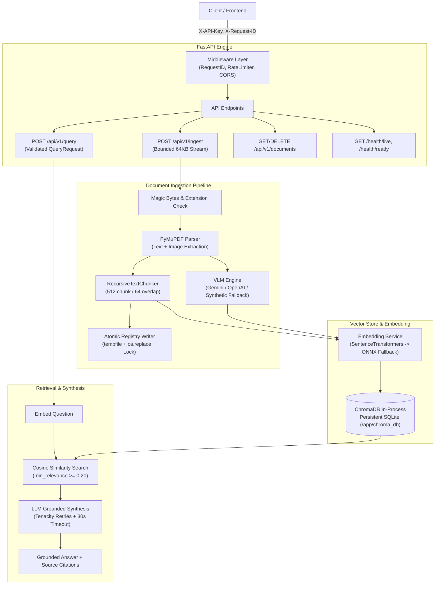
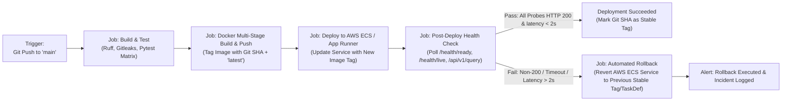

# Production Readiness Audit Map (Source of Truth)
**System Architecture & Deployment Baseline**
*Multi-Modal RAG Knowledge Engine (B.L.A.S.T. Protocol — Initialization Phase)*

---

## 1. System Overview & Technology Stack

| Domain | Technology / Component | Version / Specification | Architectural Role |
| :--- | :--- | :--- | :--- |
| **Runtime & Core** | Python, FastAPI, Starlette | Python 3.10 - 3.12, FastAPI 0.115+ | Async HTTP API, validation, routing, middleware |
| **Document Ingestion** | PyMuPDF (fitz) | 1.24+ | Text extraction, embedded raster graphic cropping |
| **Chunking Engine** | RecursiveTextChunker | Custom hierarchical recursive | Character/sentence/paragraph recursive boundary chunking |
| **Embedding Engine** | SentenceTransformers / ONNX | `all-MiniLM-L6-v2` (384-dim) | Lazy-loaded dense embeddings with automatic ONNX fallback |
| **Vector Database** | ChromaDB (In-process SQLite) | 0.5+ | Vector indexing, persistent SQLite metadata store |
| **VLM / LLM Provider** | Google Gemini / OpenAI | `gemini-1.5-flash` / `gpt-4o-mini` | Visual graphic summarization & grounded RAG synthesis |
| **Containerization** | Docker, Docker Compose | Multi-stage (`builder` + `runner`) | Linux Alpine/Debian slim, non-root `appuser` (UID 10001) |
| **CI / CD Pipeline** | GitHub Actions | Ubuntu 24.04 matrix (3.10, 3.11, 3.12) | Automated linting (`ruff`), secret scanning (`gitleaks`), pytest |

---

## 2. Architectural Topology & Ingestion / Retrieval Flow



---

## 3. Core Boundaries & Security Baseline

1. **Authentication Boundary**:
   - `X-API-Key` enforced on mutating endpoints (`/api/v1/ingest`, `/api/v1/documents/*`) and synthesis (`/api/v1/query`).
   - Health probes (`/health/live`, `/health/ready`) and OpenAPI specs remain public for orchestration and load balancer probes.
   - Credentials stored in Pydantic `SecretStr` models, preventing leakage in logs or exceptions.

2. **Input Sanitization & Streaming Defense**:
   - Filenames sanitized via `PurePosixPath` and regex to block path traversal (`../`, `..\\`, absolute paths).
   - Ingestion enforces streamed 64 KB chunk validation: aborts with `HTTP 413` if bytes exceed `max_file_size_mb` before memory buffering.
   - PDF magic bytes (`%PDF-`) enforced; spoofed text/binary files rejected immediately.

3. **Error Shielding**:
   - All internal exception messages masked with generic client-safe strings.
   - Internal paths, database traces, and provider keys stripped.
   - `X-Request-ID` correlated across error responses for backend server-side log debugging.

4. **Concurrency & Rate Limiting**:
   - Process-level sliding-window memory rate limiting (`MemoryRateLimitBackend`).
   - Pluggable distributed Redis backend (`RedisRateLimitBackend`) for multi-replica deployments.
   - SQLite ChromaDB concurrency constraint: strictly requires `--workers 1` per container instance to avoid SQLite file locking.

---

## 4. Operational Probes & Health Check Contracts

| Probe Endpoint | Target Port | Success Criteria | Unhealthy Triggers |
| :--- | :--- | :--- | :--- |
| **Liveness**: `GET /health/live` | 8000 | HTTP 200 `{"status": "alive"}` | Process crash, deadlock, or event loop starvation |
| **Readiness**: `GET /health/ready` | 8000 | HTTP 200 `{"status": "ready", "database": "connected"}` | Vector store unavailable, disk full, missing models |
| **System Info**: `GET /health` | 8000 | HTTP 200 system telemetry | Dependency degradation |
| **Smoke Query**: `POST /api/v1/query` | 8000 | HTTP 200 with grounded response | Retrieval engine failure, LLM timeout > 30s |

---

## 5. Deployment & Rollback Surface Matrix

### Deployment Target & Strategy Parameters (Confirmed)
- **Target Deployment Platform**: AWS (ECS Fargate / App Runner with Amazon ECR and EFS persistent volume for ChromaDB and uploads)
- **Deployment Branch Strategy**: Direct push/merge to `main` branch triggers production deployment pipeline
- **Automated Rollback Mechanism**: Container Image / Git SHA Rollback (re-deploying previous verified stable image tag from ECR / previous stable task definition)
- **Environment Baseline**: Root `.env.example` verified contract



---

## 6. Required Configuration Parameters (.env Baseline)

The project relies on the following verified configuration matrix defined in `.env.example`:

```bash
# Application Metadata
APP_NAME=MultiModal-RAG-Engine
APP_VERSION=1.1.0
DEBUG=false
LOG_LEVEL=INFO
LOG_FORMAT=text # or json

# Security & CORS
API_KEY=
API_KEY_HEADER_NAME=X-API-Key
CORS_ORIGINS=http://localhost:3000,http://localhost:8000,http://127.0.0.1:3000,http://127.0.0.1:8000

# Rate Limiting
RATE_LIMIT_ENABLED=true
RATE_LIMIT_REQUESTS_PER_MINUTE=60
RATE_LIMIT_BACKEND=memory # or redis
REDIS_URL=

# VLM / LLM Providers
VLM_PROVIDER=gemini # or openai
GEMINI_API_KEY=your_gemini_api_key_here
OPENAI_API_KEY=your_openai_api_key_here
VLM_MODEL_NAME=gemini-1.5-flash
VLM_MAX_CONCURRENT=5
VLM_MAX_RETRIES=3
VLM_TIMEOUT_SECONDS=30.0

# Embedding Model
EMBEDDING_MODEL_NAME=all-MiniLM-L6-v2
EMBEDDING_BATCH_SIZE=64
EMBEDDING_DIMENSION=384

# Vector DB & Storage
CHROMA_PERSIST_DIR=./chroma_db
CHROMA_COLLECTION_NAME=knowledge_base
CHUNK_SIZE=512
CHUNK_OVERLAP=64
MIN_IMAGE_DIMENSION=100
MAX_FILE_SIZE_MB=50
DUPLICATE_STRATEGY=replace

# Retrieval
DEFAULT_TOP_K=5
MIN_RELEVANCE_SCORE=0.20
MAX_CONTEXT_CHARS=8000

# Paths
UPLOAD_DIR=./data/uploads
EXTRACTED_IMAGES_DIR=./data/extracted_images
```
