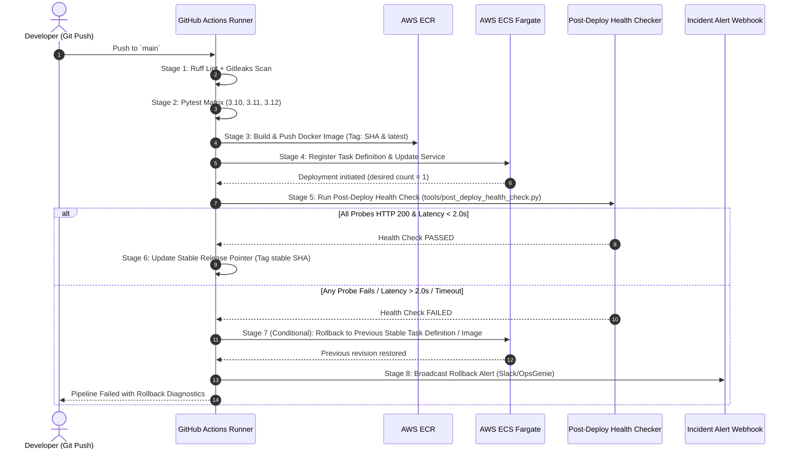

# Standard Operating Procedure (SOP): Production Deployment & Automated Rollback
**Service: Multi-Modal RAG Knowledge Engine**
**Target Infrastructure: AWS ECS Fargate / App Runner with Amazon ECR & EFS**
**Version: 1.2.0**

---

## 1. Objective & Scope

This Standard Operating Procedure defines the deterministic gating criteria, execution workflow, post-deployment health verification, and automated rollback actions for all production releases of the Multi-Modal RAG Knowledge Engine.

---

## 2. Pre-Deployment Gating Conditions (All Must Pass)

No code may be built or deployed unless the following automated gates succeed:

| Gate | Tool / Check | Requirement | Failure Action |
| :--- | :--- | :--- | :--- |
| **Linting & Code Quality** | `ruff check .` (pinned `0.6.8`) | 0 errors, 0 warnings | Block build, report file line |
| **Secret & Leak Detection** | `gitleaks` action | 0 leaks identified | Block build, revoke detected token |
| **Test Matrix** | `pytest tests/ -v` | 100% pass across Python 3.10, 3.11, 3.12 | Block build, preserve failure logs |
| **Security Configuration** | `python tools/verify_secrets.py` | Required AWS & API secrets present | Block build before deployment |
| **Docker Build** | Multi-stage `Dockerfile` | Image compiles, non-root user `appuser` (10001) | Abort push to ECR |

---

## 3. Explicit Failure Thresholds Triggering Rollback

Once an image is deployed to AWS ECS, the **Post-Deploy Health Check** executes. If any of the following deterministic conditions are met, the **Automated Rollback Engine** is triggered immediately:

1. **Liveness / Readiness Probe Failure**:
   - `GET /health/live` returns any status other than HTTP 200.
   - `GET /health/ready` returns any status other than HTTP 200 or returns `"database": "unavailable"`.
2. **Readiness Probe Latency**:
   - P95 latency for `/health/ready` exceeds **1,500 ms** over 3 consecutive attempts.
3. **Smoke Query Verification Failure**:
   - `POST /api/v1/query` with test payload returns HTTP 5xx or fails Pydantic schema validation.
   - End-to-end retrieval & synthesis latency exceeds **2,000 ms** (or configured VLM timeout).
4. **Service Startup Deadline**:
   - Target containers fail to reach `STEADY_STATE` in AWS ECS within **180 seconds** (e.g. crash loop backoff).
5. **Memory / SQLite File Lock Anomaly**:
   - Uvicorn worker process encounters SQLite database locks or `MemoryError` during initial vector store probe.

---

## 4. Deterministic Pipeline Stages



---

## 5. Rollback Execution Procedure (Automated)

When triggered via `if: failure()` in GitHub Actions:
1. **Identify Stable Target**: Retrieve the previously marked stable Git SHA or task definition revision from GitHub environment state / ECR tags.
2. **Revert ECS Service**:
   ```bash
   aws ecs update-service \
       --cluster "${ECS_CLUSTER}" \
       --service "${ECS_SERVICE}" \
       --task-definition "${PREVIOUS_STABLE_TASK_DEF}" \
       --force-new-deployment
   ```
3. **Wait for Reversion Stability**:
   ```bash
   aws ecs wait services-stable \
       --cluster "${ECS_CLUSTER}" \
       --services "${ECS_SERVICE}"
   ```
4. **Broadcast Incident Telemetry**:
   Send an automated payload to `ROLLBACK_WEBHOOK`:
   ```json
   {
       "event": "AUTOMATED_ROLLBACK_EXECUTED",
       "service": "multimodal-rag-engine",
       "failed_sha": "${{ github.sha }}",
       "restored_revision": "${PREVIOUS_STABLE_TASK_DEF}",
       "reason": "Post-deployment health check exceeded latency or returned HTTP 5xx",
       "timestamp": "2026-10-26T08:30:00Z"
   }
   ```
5. **Annotate Workflow Summary**:
   Write full failure reasons and latency metrics directly into `$GITHUB_STEP_SUMMARY`.
